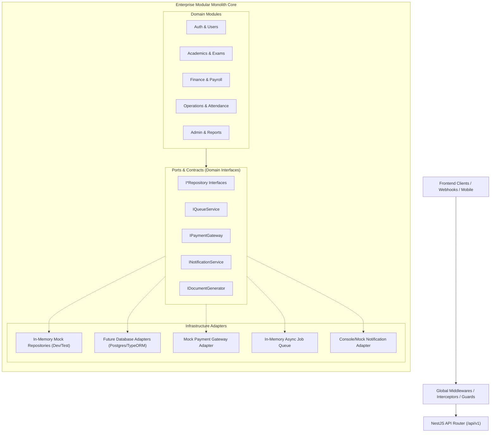

# School ERP Backend Architecture Specification

## 1. High-Level Architectural Pattern: Modular Monolith

The School ERP backend is designed as an enterprise-grade **Modular Monolith** built on **NestJS** and **TypeScript**. A modular monolith provides the structural isolation, strict domain boundaries, and independent module encapsulation of microservices, while eliminating distributed transaction overhead, network latency, and deployment complexity during early phases.



---

## 2. Layered Hexagonal (Ports & Adapters) Structure

Each functional domain adheres to strict hexagonal boundaries:

```text
src/
├── main.ts                       # Application entrypoint, bootstrap, swagger, global pipes
├── app.module.ts                 # Root NestJS module wiring domain and infrastructure modules
├── config/                       # Application configuration & environment validation
│   ├── app.config.ts
│   └── configuration.interface.ts
├── common/                       # Shared cross-cutting components
│   ├── decorators/               # @CurrentUser, @Roles, @Public
│   ├── guards/                   # JwtAuthGuard, RolesGuard, RateLimitGuard
│   ├── filters/                  # HttpExceptionFilter, GlobalExceptionFilter
│   ├── interceptors/             # TransformResponseInterceptor, LoggingInterceptor
│   ├── pipes/                    # ParseUUIDPipe, ValidationPipe
│   ├── errors/                   # DomainException, BusinessRuleViolationException
│   ├── interfaces/               # ApiResponse, PaginatedResult, RequestWithUser
│   └── utils/                    # PasswordHasher, DateHelpers, MathCalculators
├── modules/                      # Domain Modules (Clean Boundaries)
│   ├── auth/                     # Authentication (JWT, login, refresh, logout)
│   ├── users/                    # User accounts management
│   ├── roles-permissions/        # RBAC roles and permissions catalog
│   ├── students/                 # Student profiles, admissions, records
│   ├── admissions/               # Student admission workflow & validation
│   ├── staff/                    # Teaching & non-teaching staff records
│   ├── academic-years/           # Academic sessions, terms, active year switch
│   ├── classes-sections/         # Classes, sections, student allocation
│   ├── masters-settings/         # School configuration, house masters, categories
│   ├── attendance/               # Daily attendance logging, duplicate prevention
│   ├── qr-attendance/            # Time-bounded QR code generation & verification
│   ├── academics/                # Subjects, syllabus, classroom allocation
│   ├── examinations/             # Exam scheduling, conflict detection, exam halls
│   ├── results-grading/          # Marks entry, grading criteria, report generation
│   ├── admit-cards/              # Exam admit card eligibility & generation
│   ├── id-cards-certificates/    # Student/Staff ID cards, Bonafide, Transfer Certs
│   ├── leave-management/         # Staff & student leave applications & approval
│   ├── school-bell/              # Timetable bell schedule & automated events
│   ├── messaging/                # Internal announcements & notice board
│   ├── front-desk/               # Visitor logs, phone logs, front desk enquiries
│   ├── fee-management/           # Fee structures, heads, discounts, instalments
│   ├── fee-ledger/               # Student fee accounts, balances, invoice statements
│   ├── payments/                 # Server-side checkout, verification, refunds
│   ├── reconciliation/           # Payment reconciliation, transaction settlement
│   ├── payroll/                  # Staff salary structures, allowances, deductions
│   ├── accounts-expenses/        # School income, expenses, vouchers, ledgers
│   ├── inventory/                # Stock items, warehouses, stock movements
│   ├── library/                  # Book catalog, issue/return circulation, overdue fines
│   ├── transport/                # Bus routes, stops, vehicle allocation, capacity
│   ├── dashboard/                # Role-specific executive KPIs and statistics
│   ├── reports/                  # Aggregated academic, financial & operational reports
│   ├── audit-logs/               # Immutable audit log recording user actions
│   └── health/                   # System health & readiness probes
├── infrastructure/               # Implementation Adapters for Ports
│   ├── repositories/             # Repository interfaces & In-Memory implementations
│   │   ├── interfaces/           # IUserRepository, IStudentRepository, etc.
│   │   └── in-memory/            # MockUserRepository, MockStudentRepository, etc.
│   ├── payment-gateways/         # Payment provider abstractions & mock gateway
│   ├── notifications/            # Email, SMS, Push notification providers
│   ├── document-generation/      # PDF & printable certificate generator abstractions
│   ├── file-storage/             # File upload/storage service abstraction
│   ├── background-jobs/          # Queue interfaces & in-memory async runner
│   └── observability/            # Structured logging and request tracing
└── tests/
    ├── unit/                     # Business logic and calculation tests
    ├── integration/              # Multi-service workflow integration tests
    └── e2e/                      # End-to-end API HTTP tests
```

---

## 3. Database-Independent Repository Pattern

### 3.1. Design Decoupling Mandate
Business services **must never import a database client, ORM model, or persistence library**. Instead, they declare a dependency on an interface token.

Example pattern:

```typescript
// 1. Pure Domain Model (src/modules/students/domain/student.entity.ts)
export class Student {
  id: string;
  admissionNumber: string;
  firstName: string;
  lastName: string;
  dateOfBirth: Date;
  gender: string;
  classId: string;
  sectionId: string;
  academicYearId: string;
  parentEmail: string;
  emergencyContact: string;
  status: 'ACTIVE' | 'INACTIVE' | 'TRANSFERRED' | 'GRADUATED';
  createdAt: Date;
  updatedAt: Date;
}

// 2. Pure Repository Port (src/infrastructure/repositories/interfaces/student-repository.interface.ts)
export interface IStudentRepository {
  findById(id: string): Promise<Student | null>;
  findByAdmissionNumber(admissionNumber: string): Promise<Student | null>;
  findAll(filters: { classId?: string; sectionId?: string; status?: string }): Promise<Student[]>;
  create(student: Omit<Student, 'id' | 'createdAt' | 'updatedAt'>): Promise<Student>;
  update(id: string, updates: Partial<Student>): Promise<Student>;
  count(filters?: Record<string, any>): Promise<number>;
}

// 3. Application Service (src/modules/students/students.service.ts)
@Injectable()
export class StudentsService {
  constructor(
    @Inject('IStudentRepository')
    private readonly studentRepository: IStudentRepository,
  ) {}

  async enrollStudent(dto: CreateStudentDto): Promise<Student> {
    const existing = await this.studentRepository.findByAdmissionNumber(dto.admissionNumber);
    if (existing) {
      throw new ConflictException(`Student with admission number ${dto.admissionNumber} already exists`);
    }
    return this.studentRepository.create(dto);
  }
}
```

### 3.2. Unit of Work Contract
A `IUnitOfWork` interface is established in `src/infrastructure/repositories/interfaces/unit-of-work.interface.ts` to manage multi-repository transactional boundaries (e.g., student admission + fee invoice creation + user account generation).

```typescript
export interface IUnitOfWork {
  startTransaction(): Promise<void>;
  commit(): Promise<void>;
  rollback(): Promise<void>;
  runInTransaction<T>(work: () => Promise<T>): Promise<T>;
}
```

---

## 4. Cross-Cutting Concerns & Pipeline

Every incoming request passes through an enterprise pipeline:

1. **Correlation ID & Tracing:** The `LoggingInterceptor` captures or generates an `x-request-id` header, attaches it to the request context, and writes structured access logs.
2. **Rate Limiting:** `RateLimitGuard` prevents brute force and denial-of-service on sensitive routes (authentication, payments, QR generation).
3. **Authentication:** `JwtAuthGuard` validates the Bearer token, decodes claims, and populates `req.user`.
4. **Authorization (RBAC):** `RolesGuard` verifies that `req.user.role` matches the allowed `@Roles(...)` metadata on the handler or controller.
5. **Validation & Transformation:** Global `ValidationPipe` enforces schema conformity via `class-validator`, transforms types, and strips extraneous non-whitelisted properties.
6. **Business Logic Execution:** Domain service performs validations, calculations, and domain state mutations.
7. **Response Standardization:** `TransformResponseInterceptor` wraps service output into the unified `{ success: true, statusCode, message, data, meta }` envelope.
8. **Centralized Error Handling:** `HttpExceptionFilter` intercepts exceptions, logs stack traces securely, and returns formatted error payloads without exposing internal leaks.

---

## 5. Domain Decomposition & Key Business Capabilities

### 5.1. Core School & People Management
- **Auth & RBAC:** Complete token lifecycle (issue, refresh, revoke), password encryption, role matrix for 10 roles.
- **Students & Admissions:** Unique admission number sequencing, student profile management, sibling linking, document attachment records.
- **Staff & HR:** Faculty and operational staff profiles, designation, department, qualification, and contact details.
- **Academic Years & Sessions:** Academic calendar management, term dates, and active session flag.
- **Classes & Sections:** Capacity enforcement, section allocation, class teacher assignments.
- **Masters & Settings:** School profile, branding, house system, blood groups, and custom categories.

### 5.2. Academic & Assessment Management
- **Academics:** Subjects, syllabus tracking, class-subject teacher mapping.
- **Examinations:** Exam periods, exam types (Formative, Summative), scheduling with conflict detection (no teacher/hall double booking).
- **Results & Grading:** Dynamic grading scales (A1, A2, B1...), marks entry, weighted term calculations, SGPA/CGPA generation.
- **Admit Cards & ID Cards:** Hall ticket generation with eligibility check (fee dues clearance & attendance threshold).
- **Certificates:** Transfer Certificates (TC) with leaving status, Bonafide and Character certificates.

### 5.3. Finance & Resources Management
- **Fee Management:** Fee heads (Tuition, Transport, Lab, Admission), academic year fee structures, discount rules, instalment schedules.
- **Invoicing & Ledger:** Automated term invoice generation, real-time student ledger with debit/credit balance computations.
- **Payments & Gateway:** Server-side checkout session creation, webhook processing with HMAC signature verification, idempotency protection, automated receipt issuance.
- **Reconciliation:** Bank settlement matching, discrepancy tracking, refund and reversal audits.
- **Payroll:** Staff salary master (Basic, HRA, DA, PF deductions, Tax), monthly payroll batch runs, approval workflow, payslip generation.
- **Accounts & Expenses:** Chart of accounts, expense vouchers, vendor payments, financial reports (Income vs Expense).
- **Inventory & Stock:** Item categories, inventory stores, reorder levels, stock movements (Inward, Outward, Adjustment, Write-off).
- **Library Management:** ISBN cataloging, book barcode tracking, borrowing rules, overdue fine calculation engine.
- **Transport:** Routes, bus stops, vehicle telemetry metadata, student route allocation, vehicle capacity limits.

### 5.4. School Operations
- **Daily Attendance:** Student & staff daily attendance (Present, Absent, Late, Excused), duplicate submission prevention.
- **QR Code Attendance:** Cryptographically signed time-limited QR codes with 60-second TTL to prevent attendance spoofing.
- **Leave Management:** Multi-tier leave applications, entitlement tracking, approval/rejection workflows.
- **School Bell & Timetable:** Timetable slot generation, automated bell event triggers.
- **Messaging:** Role-targeted school broadcasts, direct parent-teacher communications.
- **Front Desk:** Visitor check-in/out badges, phone call logs, admission enquiry tracking.

### 5.5. Dashboard & Analytics
- **Executive Dashboard:** Real-time KPI aggregation (Enrollment count, Today's attendance %, Total fee collected vs outstanding, Staff on leave).
- **Reports Engine:** Export-ready aggregated metrics for compliance, finance, and academics.
- **Audit Logging:** Immutable chronological activity trail capturing user ID, IP address, resource, action, and timestamp.

---

## 6. Infrastructure Abstractions

| Interface | Default Dev Implementation | Production Target |
| :--- | :--- | :--- |
| `I*Repository` | In-Memory HashMaps with UUID keys | TypeORM / PostgreSQL Repository |
| `IQueueService` | In-Memory Event Emitter / Async Queue | BullMQ + Redis |
| `IPaymentGateway` | `MockPaymentGateway` (deterministic test tokens) | Stripe / Razorpay / PayPal API |
| `INotificationService` | `MockNotificationService` (console & memory log) | SendGrid (Email), Twilio (SMS), FCM (Push) |
| `IDocumentGenerator` | `MockDocumentGenerator` (base64 dummy PDFs) | Puppeteer / PDFKit / S3 Bucket |
| `IFileStorage` | `MockFileStorageService` (virtual memory paths) | AWS S3 / Google Cloud Storage |

---

## 7. Future Database Integration Handover Strategy

When the time arrives to connect a production database (e.g., PostgreSQL):
1. **Zero Domain Rewrites:** The `modules/` layer remains completely untouched.
2. **Provider Swap:** In each module's NestJS module file (e.g., `students.module.ts`), change the provider definition:
   ```typescript
   // Before (Current Phase):
   { provide: 'IStudentRepository', useClass: InMemoryStudentRepository }

   // After (Database Phase):
   { provide: 'IStudentRepository', useClass: PostgresStudentRepository }
   ```
3. **Database Handover Document:** Complete mapping of all domain models, relations, field constraints, unique keys, and indexes will be provided in `database-handover.md`.
