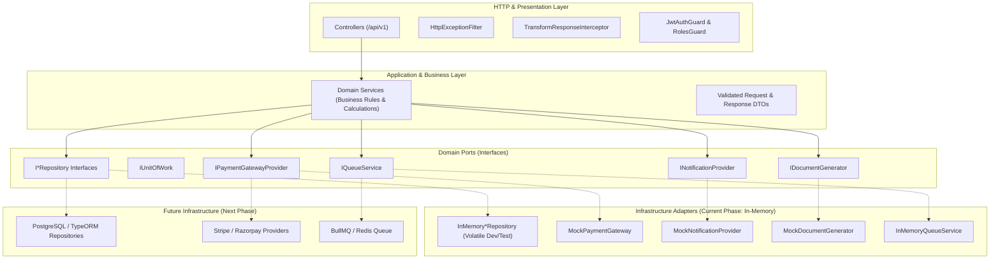

# School ERP Backend Master Engineering Protocol

> **Document Classification:** High-Priority Enterprise Engineering Protocol  
> **Target Project:** School ERP Backend (Database Integration Phase Later)  
> **Assigned Developers:** K.H (Lead & Security), K.S (Academics & Logistics), V dev (Finance & Operations)  
> **Execution Window:** 4 Days  

---

## Table of Contents
1. [Master Executive Summary](#1-master-executive-summary)
2. [Section I: Binding Rules & Constraints (from rule.md)](#2-section-i-binding-rules--constraints)
3. [Section II: System Architecture & Design Patterns (from architecture.md)](#3-section-ii-system-architecture--design-patterns)
4. [Section III: 4-Day Development Plan & Work Breakdown (from days.md)](#4-section-iii-4-day-development-plan--work-breakdown)
5. [Section IV: Developer Execution Protocols & Quality Standards](#5-section-iv-developer-execution-protocols--quality-standards)
6. [Section V: Database Integration Handover Protocol](#6-section-v-database-integration-handover-protocol)

---

## 1. Master Executive Summary

This Master Engineering Protocol establishes the single source of truth for developing the backend of the School ERP system. The frontend modules are in parallel development by dedicated teams; this backend exposes robust, secure, and documented REST APIs (`/api/v1`) while strictly maintaining database independence.

The persistence layer is decoupled through clean Repository and Unit of Work interfaces. All business logic is implemented and tested using in-memory mock adapters that log warnings about data volatility. When a production database is introduced in a future phase, it can be plugged in without modifying a single line of business or controller code.

---

## 2. Section I: Binding Rules & Constraints

### 2.1. Strict Prohibitions
1. **Zero Database Implementations:**
   - No database engines (Postgres, MySQL, Mongo, SQLite, Redis, etc.) may be connected or configured.
   - No database drivers (`pg`, `mysql2`, `mongodb`) or ORM packages (`typeorm`, `prisma`, `mongoose`) may be installed.
   - No database migration files, schemas, collection definitions, or connection pools may be created.
2. **Zero Frontend Interference:**
   - Do not build, alter, or redesign the frontend application.
   - Exclusively author backend NestJS modules, DTOs, controllers, services, repository interfaces, and tests.
3. **No False Permanence:**
   - In-memory data is volatile and resets on server restart. Never present mock persistence as production storage.
4. **Honest Integration Reporting:**
   - External services (Email, SMS, Payment Gateways) are simulated via clean provider abstractions. Never claim external systems are connected until verified with production credentials.

### 2.2. Technology Stack Mandate
- **Runtime:** Node.js v20+ LTS / v22+ LTS
- **Language:** TypeScript v5.x with strict typing
- **Framework:** NestJS v10.x (Modular Monolith)
- **API Style & Versioning:** REST API with global prefix `/api/v1`
- **Documentation:** Swagger/OpenAPI generated via `@nestjs/swagger`
- **Authentication:** JWT Access Tokens (15 min) + Refresh Tokens (7 days) with rotation
- **Authorization:** RBAC covering 10 explicit roles:
  1. `Super Admin`
  2. `School Admin`
  3. `Accountant`
  4. `Teacher`
  5. `HR / Payroll Staff`
  6. `Librarian`
  7. `Transport Manager`
  8. `Front Desk Staff`
  9. `Parent`
  10. `Student`
- **Validation:** `class-validator` & `class-transformer` with `{ whitelist: true, forbidNonWhitelisted: true, transform: true }`
- **Testing:** Automated unit and E2E tests using Jest and Supertest
- **Background Processing:** Queue abstraction with future BullMQ/Redis adapter
- **Logging:** Structured JSON logging with Correlation IDs (`x-request-id`)
- **Deployment Readiness:** Dockerfile, docker-compose, and GitHub Actions CI workflow

### 2.3. Financial & Security Safeguards
- **Server-Side Payments:** Payment amounts must be computed strictly on the backend from outstanding fee ledgers.
- **Webhook Security:** Webhook payloads must verify HMAC cryptographic signatures and enforce idempotency to prevent duplicate charges.
- **Receipt Generation:** Receipts are exclusively generated for payments in `COMPLETED` state.
- **Password Hashing:** Passwords hashed with `bcrypt` (10 rounds). Plaintext passwords must never be stored or logged.

---

## 3. Section II: System Architecture & Design Patterns

### 3.1. Modular Monolith & Hexagonal Ports & Adapters
The application is organized into independent, highly cohesive domain modules. Business logic is insulated from external dependencies via ports (interfaces) and adapters (in-memory mocks).



### 3.2. Uniform Response and Error Envelopes

#### Success Envelope:
```json
{
  "success": true,
  "statusCode": 200,
  "message": "Operation completed successfully",
  "data": {},
  "meta": {
    "requestId": "6a9f7d24-118d-4b72-a128-49de03d3bc42",
    "timestamp": "2026-10-23T18:00:00.000Z",
    "pagination": {
      "page": 1,
      "limit": 20,
      "total": 100,
      "totalPages": 5
    }
  }
}
```

#### Error Envelope:
```json
{
  "success": false,
  "statusCode": 400,
  "error": "Bad Request",
  "message": "Student with admission number ADM-2026-001 already exists",
  "details": [],
  "meta": {
    "requestId": "6a9f7d24-118d-4b72-a128-49de03d3bc42",
    "timestamp": "2026-10-23T18:00:00.000Z"
  }
}
```

---

## 4. Section III: 4-Day Development Plan & Work Breakdown

### Day 1: Foundations, Identity, Scheduling & Invoicing
- **K.H:** Project setup, `common/` layer (filters, interceptors, guards), base repository interfaces, `auth/` (JWT, login, refresh, logout), `users/`, and `roles-permissions/`.
- **K.S:** `academics/` (subjects, syllabus), `examinations/` (exam setup, periods, schedule engine with collision detection).
- **V dev:** `fee-management/` (fee heads, structures, instalment plans), `fee-ledger/` (student accounts, real-time balance calculations, automated invoicing).

### Day 2: People Management, Marks Processing & Payment Processing
- **K.H:** `students/` (profiles, admission numbering), `admissions/`, `staff/` (HR records), `academic-years/`, `classes-sections/`, and `masters-settings/`.
- **K.S:** `results-grading/` (marks entry, score validation, CGPA/percentage computation, pass/fail rules, report cards, publishing).
- **V dev:** `infrastructure/payment-gateways/` (abstraction), `payments/` (checkout, status), webhook processing (signature verification, idempotency), `reconciliation/`, and receipts.

### Day 3: School Operations, Documents & Payroll Engine
- **K.H:** `attendance/` (daily logging, duplicate prevention), `qr-attendance/` (time-limited signed QR tokens), `leave-management/` (approval workflow), `school-bell/`, and `messaging/`.
- **K.S:** `infrastructure/document-generation/` (abstraction), `admit-cards/` (eligibility check on dues & attendance), `id-cards-certificates/` (Student/Staff IDs, Bonafide, Transfer Certificates).
- **V dev:** `payroll/` (salary structures, allowances, deductions, monthly runs, payslips), `accounts-expenses/` (chart of accounts, vouchers, income vs expense).

### Day 4: Logistics, Analytics, Hardening, CI/CD & Final Delivery
- **K.H:** `front-desk/` (visitor badges, calls, postal, enquiries), `audit-logs/`, security hardening (Helmet, CORS, rate limits), E2E integration lead.
- **K.S:** `library/` (catalog, circulation, loans, return, overdue fines), `transport/` (routes, vehicles, student allocations, capacity limits), academic E2E tests.
- **V dev:** `inventory/` (items, stock movements, adjustments), `dashboard/` (executive summary KPIs), `reports/`, `health/` probes, Docker & CI/CD pipeline.

---

## 5. Section IV: Developer Execution Protocols & Quality Standards

### 5.1. Git Branching & Commit Conventions
- **Main Branch:** `main` (protected; requires clean CI and review).
- **Feature Branches:**
  - `feature/kh-day1-auth-core`
  - `feature/ks-day1-academics-exams`
  - `feature/vdev-day1-fee-invoicing`
- **Commit Messages:** Must follow Conventional Commits (`feat(auth): implement refresh token rotation`, `fix(fees): prevent negative invoice balance`, `test(attendance): add duplicate check unit test`).

### 5.2. Pull Request & Review Checklist
Before any PR is merged into `main`, the author and peer reviewer must check off:
- [ ] No database drivers, ORMs, schemas, or migrations were introduced.
- [ ] Controller strictly invokes domain service and does not interact with persistence directly.
- [ ] Domain service depends on repository interface token via NestJS DI.
- [ ] DTO inputs have `class-validator` annotations with strict typing.
- [ ] Endpoints are guarded with appropriate `@Roles(...)` metadata.
- [ ] Unit tests cover business calculations and edge conditions.
- [ ] Swagger annotations are applied (`@ApiOperation`, `@ApiResponse`).
- [ ] `npm run build` succeeds without TypeScript compilation errors.

---

## 6. Section V: Database Integration Handover Protocol

When the future database engineering team begins connecting a persistent database:
1. **Repository Provider Replacement:**
   In each module's NestJS module declaration, update the provider mapping:
   ```typescript
   // FROM IN-MEMORY (CURRENT):
   {
     provide: 'IStudentRepository',
     useClass: InMemoryStudentRepository,
   }

   // TO DATABASE ADAPTER (FUTURE):
   {
     provide: 'IStudentRepository',
     useClass: PostgresStudentRepository,
   }
   ```
2. **Zero Service Refactoring:** No service in `src/modules/*` needs to be rewritten or touched, preserving 100% of the verified business rules, calculations, and validations.
3. **Transactional Integrity:** Use the `IUnitOfWork` provider implementation for wrapping multi-table atomic operations (e.g., student admission + fee billing + ledger initialization).
